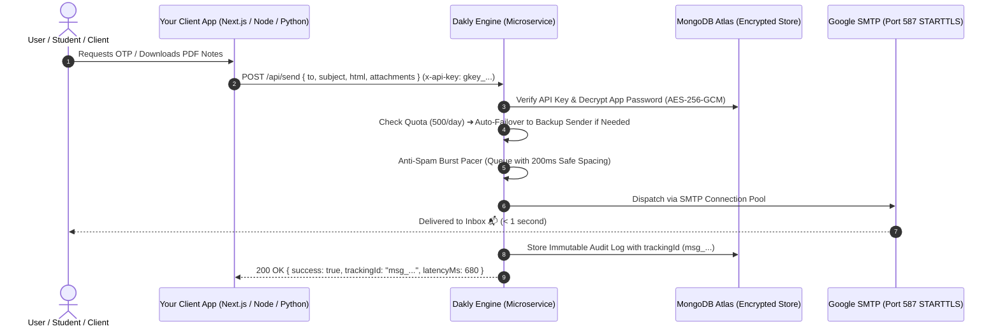

# 📮 Dakly

> **The Zero-Cost, Headless Transactional Email Engine for Developers.**  
> Send OTPs, custom HTML emails, study notes, receipts, and PDF attachments across all your projects with a single API call — powered by your own Gmail SMTP accounts with zero monthly subscription fees.

[](https://github.com/parthpatil1234p-svg/Dakly/actions)
[](LICENSE)
[](docs/)
[](CONTRIBUTING.md)
[](SECURITY.md)

---

### 📚 Official Documentation
- 🏛️ **[System Architecture](docs/ARCHITECTURE.md)**: Deep dive into pacing, queues, encryption & data models.
- 📡 **[REST API Reference](docs/API_REFERENCE.md)**: Comprehensive endpoint catalog, schemas & status codes.
- 🔔 **[Webhooks Guide](docs/WEBHOOKS.md)**: Event catalog, HMAC-SHA256 signature verification & multi-language examples.
- ⚡ **[Developer SDK Guide](docs/SDK_GUIDE.md)**: Node.js (`npm i dakly`) & Python (`pip install dakly`) setup.
- 🤝 **[Contributing Guidelines](CONTRIBUTING.md)**: Dev setup, testing workflows, and PR submission rules.
- 📜 **[Changelog](CHANGELOG.md)**: Semantic release history & feature updates.

---

## 💡 The Problem vs. The Dakly Solution

| Traditional Email (SendGrid / Resend / AWS SES) | Doing Nodemailer in Every Project | 📮 The Dakly Way |
| :--- | :--- | :--- |
| 💳 Requires credit cards & complex domain DNS (SPF, DKIM) verification | 🔄 Copy-pasting Nodemailer configs into 10 different repositories | ⚡ **Zero-Setup Delivery:** 1 HTTP `POST` request from any codebase |
| 💸 Expensive recurring bills once low free tiers expire | ⚠️ Exposing Google App Passwords in multiple `.env` files | 🔐 **Military-Grade AES-256-GCM:** Passwords encrypted at rest |
| ⏱️ Cold start timeouts (10-15s) on serverless lambdas | 🔴 Port 465 SSL handshake timeouts on cloud firewalls | 🚀 **Persistent STARTTLS (Port 587):** OTP delivery in < 1 second |
| 📉 Hard daily limit of 500 emails/day on free Gmail | 🚫 Risk of temporary account ban on rapid bursts | 🛡️ **Failover & Pacing:** Dual-senders (1,000+/day) + 200ms anti-burst spacing |

---

## 🌟 What Dakly Can Do For Your Project (Full Capabilities Matrix)

By plugging Dakly into your project, your application instantly gets an enterprise-grade transactional email infrastructure with **zero monthly subscription fees**:

| Feature | What It Does For Your Application | Why It Matters |
| :--- | :--- | :--- |
| ⚡ **Sub-Second OTP & Auth Delivery** | Sends 4–6 digit OTPs, magic sign-in links, and password resets in **under 1 second** | Eliminates user drop-off during onboarding and user verification |
| 🎨 **100% Headless HTML Freedom** | Renders any HTML/CSS layout (welcome cards, receipts, status alerts, newsletters) | Complete design freedom without restrictive email templates |
| 📎 **Multi-Format Attachment Engine** | Delivers PDFs, Images, Spreadsheets, Word docs, and ZIP files (up to **15MB**) via remote URL or base64 | Perfect for auto-delivering study notes, invoices, receipts, and reports |
| 🔀 **Dual-Sender Failover Pool** | Automatically switches from Primary Gmail to Backup Gmail when 500 emails/day limit is reached | Doubles free capacity to **1,000+ emails/day** with zero downtime |
| ⏱️ **Anti-Spam Burst Pacing Queue** | Automatically spaces rapid burst traffic with a 200ms safe spacing queue | Prevents Google rate-limit blocks (`421/454`) and keeps emails out of spam |
| 🛡️ **Zero-Crash Cloud Reliability** | Uses persistent STARTTLS on Port 587 with connection pooling | Eliminates cloud timeout freezes (`ETIMEDOUT`) on Vercel, Render, AWS, and Heroku |
| 🔐 **Military-Grade AES-256-GCM** | Encrypts Google App Passwords with unique IVs and authenticated tags | Prevents credential leaks; passwords are never stored in plaintext |
| 📊 **Real-Time Audit & Tracking Logs** | Generates an immutable tracking ID (`msg_...`) with millisecond latency logging | Instant visibility into delivery success, bounces, and timestamps |
| 🔔 **HMAC Delivery Webhooks** | Real-time HMAC-SHA256 authenticated webhooks for delivery, failure, suppression, opens, and clicks | Keeps your backend database updated with asynchronous two-way delivery telemetry |
| 🛡️ **Server IP Whitelisting & Key Rotation** | Bind API keys to specific server IPs (exact, CIDR `/24`, or wildcard `*`) + 1-click zero-downtime key rotation | Prevents stolen API keys from quota misuse and hardens production infrastructure |
| 👥 **Team Workspaces & Multi-Seat RBAC** | Multi-developer project collaboration with Owner, Admin, and Viewer permissions | Collaborate seamlessly with team members without sharing developer passwords |
| 🖼️ **1:1 Brand Logo & Anti-Piracy Guard** | Strict 1:1 square brand logo (1 per project) with magic-byte anti-malware/piracy inspection | Renders high-trust brand logo in outgoing emails while blocking fake media/torrents |
| 📧 **Pre-built Templates & Variable Engine** | 5 built-in responsive templates (OTP, Welcome, Password Reset, College Notes, Receipts) with dynamic `vars` | Zero HTML design work needed; dynamic interpolation with project branding |
| 📊 **Open & Click Tracking Analytics** | 1x1 zero-latency transparent pixel + phishing-safe link redirects + device breakdown (Mobile vs Desktop) | Real-time engagement telemetry & webhooks (`email.opened`, `email.clicked`) without 3rd-party dependencies |
| 🛡️ **Smart Warm-up & Bounce Protection** | Progressive 6-day ramp ladder (25 -> 500) + automatic hard-bounce suppression list | Protects Gmail account health, sender reputation, and avoids Google SMTP rate bans |
| ⚡ **Official Zero-Dependency SDKs** | Official Node.js/TypeScript (`npm i dakly`) and Python (`pip install dakly`) libraries + single-file drop-ins | Type-safe autocomplete, 1-liner OTPs, auto-retries, and instant error handling |
| 💻 **Raw Fetch / Zero Overhead Option** | Full headless flexibility: send emails using raw `fetch()` or `curl` with 0 package dependencies | Keeps your client application lightweight, clean, and bug-free |

---

## 🏗️ How It Works (Architecture)



---

## 🚀 Step 1: Get Your API Key

### Option A: Via Modern Web Dashboard (Recommended)
1. Open the **Dakly Dashboard** (locally at `http://localhost:5173` or on your hosted Vercel link).
2. Click **Create an account** (Register with Name, Email, Password).
3. Go to **Projects** ➔ Click **"+ Add Project"**:
   - **Project Name:** e.g., `College Notes Hub` or `Disheera Portal`
   - **Sender Gmail:** Your Gmail address (e.g. `yourname@gmail.com`)
   - **Google App Password:** Your 16-character Google App Password ([Generate one here](https://myaccount.google.com/apppasswords))
4. Click **Save Project** ➔ Copy your generated API Key (`gkey_live_...`).

### Option B: Via Developer API (Headless Registration)
```bash
# 1. Register Developer Account
curl -X POST https://dakly-engin.vercel.app/api/auth/register \
  -H "Content-Type: application/json" \
  -d '{"name": "Dev User", "email": "dev@example.com", "password": "yourPassword123"}'

# 2. Create Project & Obtain API Key
curl -X POST https://dakly-engin.vercel.app/api/projects \
  -H "Content-Type: application/json" \
  -H "Authorization: Bearer <YOUR_JWT_TOKEN>" \
  -d '{
    "name": "My App",
    "senderEmail": "mybot@gmail.com",
    "appPassword": "abcd efgh ijkl mnop"
  }'
```

---

## 🤖 1-Click AI Integration Prompt (Drop-in for Any Project)

> [!TIP]
> **Using an AI Coding Assistant (Cursor, GitHub Copilot, Antigravity, ChatGPT, Claude)?**  
> You don't need to write or refactor code manually! Just copy the readymade prompt below, replace `<YOUR_DAKLY_API_KEY>` with your key, and paste it into your AI assistant inside your project.  
> 
> The AI will automatically inspect your project, detect if you have an existing (broken) email system, replace it without breaking your routes, or create a brand new OTP delivery flow tailored to your tech stack.

```text
You are a senior backend engineer. I need to integrate fast, reliable OTP email delivery into this project using the Dakly Email Engine microservice.

Here are my Dakly Microservice details:
- API Endpoint: https://dakly-engin.vercel.app/api/send
- API Key: <REPLACE_WITH_YOUR_DAKLY_API_KEY>
- Required Header: "x-api-key: <YOUR_API_KEY>"
- HTTP Method: POST
- Payload Schema:
  {
    "to": "recipient@email.com",
    "subject": "Your Verification Code: 123456",
    "html": "<styled html template>",
    "text": "Your OTP code is 123456"
  }

Please execute this integration in my project by following these steps:

1. CODEBASE RECON:
   - Scan my repository to see if an email sending mechanism already exists (e.g. Nodemailer, SendGrid, custom SMTP) or if auth/OTP routes (signup, login, forgot-password) are defined.
   - Identify the framework (Express, Next.js, NestJS, FastAPI, Django, Laravel, etc.) and environment setup (.env).

2. ADAPTIVE IMPLEMENTATION:
   - [SCENARIO A - Existing Email System]: If my codebase already has an email sending function or file (e.g. mailer.js, nodemailer.ts, sendMail.js) that is throwing errors or timeouts, perform a "Drop-in Replacement". Keep the existing function name and parameters so NONE of my existing controllers or routes break, but swap out the broken transport with the Dakly API fetch call.
   - [SCENARIO B - New Setup]: If no email helper exists, create a clean, modular emailService (or otpService) helper and export a sendOtp(to, otp, name) function.

3. RESPONSIVE OTP HTML TEMPLATE:
   - Design a modern, clean HTML card with my project's theme containing:
     - Clear OTP display with styled background, large bold typography, and letter spacing.
     - 10-minute expiration notice.
     - Security disclaimer ("Never share this code with anyone").

4. SECRETS & ENVIRONMENT HYGIENE:
   - Add DAKLY_API_KEY="<YOUR_API_KEY>" and DAKLY_API_URL="https://dakly-engin.vercel.app/api/send" to my .env file (and mirror placeholders in .env.example).
   - Never hardcode the API key in source code.

5. INTERACTIVE CLARIFICATIONS:
   - If you are unsure where OTP generation is triggered or which routes handle verification, ask me clarifying questions one by one before modifying any sensitive routes.
   - Once confirmed, implement the solution and provide a quick test command.
```

---

## ⚡ Official Dakly SDK (Node.js, TypeScript & Python)

Dakly provides zero-dependency official client libraries with TypeScript autocomplete, automatic retry, and built-in bounce suppression error handling.

### 📦 Node.js / TypeScript (`npm i dakly`)
```bash
npm install dakly
```

```javascript
import { Dakly, DaklySuppressedError } from 'dakly';

const dakly = new Dakly(process.env.DAKLY_API_KEY || 'gkey_live_...');

// 1. Send OTP Verification Code (1-Liner)
const otpRes = await dakly.sendOtp({
  to: 'user@example.com',
  code: '849201',
  appName: 'CampusPortal',
  expiresInMinutes: 10
});
console.log('Delivered! Tracking ID:', otpRes.trackingId);

// 2. Pre-Built Responsive Email Templates (Welcome, Reset, Invoice, Notes)
await dakly.sendWelcome({
  to: 'founder@startup.com',
  name: 'Rahul Sharma',
  appName: 'Dakly Cloud',
  loginUrl: 'https://dakly.vercel.app/login'
});

// 3. College Notes & PDF Attachment Delivery
await dakly.sendNotes({
  to: 'student@college.edu',
  studentName: 'Amit',
  subjectName: 'Computer Networks',
  notesTitle: 'Unit 3: TCP Congestion Control',
  downloadUrl: 'https://college.edu/notes/cn-unit3.pdf',
  attachments: [{ filename: 'CN_Notes.pdf', path: 'https://college.edu/notes/cn-unit3.pdf' }]
});

// 4. Ping Connection & Live Quota
const ping = await dakly.ping();
console.log('Remaining emails today:', ping.capacity.remainingToday, '/', ping.capacity.totalDailyQuota);
```

### 🐍 Python 3.8+ (`pip install dakly`)
```bash
pip install dakly
```

```python
from dakly import Dakly, DaklySuppressedError

dakly = Dakly("gkey_live_...")

# 1-Liner OTP
res = dakly.send_otp(to="student@example.com", code="849201", app_name="StudyHub")
print("Delivered! Tracking ID:", res["trackingId"])

# Welcome Onboarding
dakly.send_welcome(to="newuser@example.com", name="Rahul", app_name="StudyHub")

# Health Ping
ping = dakly.ping()
print("Remaining quota today:", ping["capacity"]["remainingToday"])
```

---

## 📦 Step 2: Raw Fetch / HTTP Implementation (Zero Dependencies)

If you prefer calling the raw REST API without installing an SDK, you don't need `nodemailer` or SMTP. Just make a standard `fetch` or HTTP call in your language of choice.

### 1. Node.js / Express / Next.js (JavaScript / TypeScript)

Create a helper file `emailHelper.js` in your project:

```javascript
// emailHelper.js
const DAKLY_API_KEY = process.env.DAKLY_API_KEY || "gkey_live_YOUR_API_KEY";
const DAKLY_ENDPOINT = "https://dakly-engin.vercel.app/api/send";

/**
 * Send OTP Verification Email
 */
export async function sendOtpEmail(to, otpCode, userName = "User") {
  const response = await fetch(DAKLY_ENDPOINT, {
    method: "POST",
    headers: {
      "Content-Type": "application/json",
      "x-api-key": DAKLY_API_KEY
    },
    body: JSON.stringify({
      to,
      subject: `Your Verification Code: ${otpCode}`,
      html: `
        <div style="font-family: Arial, sans-serif; padding: 24px; border: 1px solid #e2e8f0; border-radius: 12px; max-width: 480px;">
          <h2 style="color: #1e293b; margin-top: 0;">Welcome, ${userName}! 👋</h2>
          <p style="color: #475569; font-size: 15px;">Use the following 6-digit code to complete your verification:</p>
          <div style="background: #f1f5f9; padding: 14px; text-align: center; border-radius: 8px; font-size: 30px; font-weight: bold; letter-spacing: 6px; color: #4f46e5; margin: 20px 0;">
            ${otpCode}
          </div>
          <p style="color: #94a3b8; font-size: 13px; margin-bottom: 0;">This code expires in 10 minutes. If you did not request this, please ignore this email.</p>
        </div>
      `
    })
  });

  return await response.json();
}

/**
 * Send Notes / Invoices / PDF Documents
 */
export async function sendPdfDocument(to, title, pdfUrl) {
  const response = await fetch(DAKLY_ENDPOINT, {
    method: "POST",
    headers: {
      "Content-Type": "application/json",
      "x-api-key": DAKLY_API_KEY
    },
    body: JSON.stringify({
      to,
      subject: `Your Document: ${title}`,
      html: `
        <div style="font-family: Arial, sans-serif; padding: 20px;">
          <h2>Here is your document: ${title} 📄</h2>
          <p>Please find the requested PDF attached to this email.</p>
        </div>
      `,
      attachments: [
        {
          filename: `${title}.pdf`,
          path: pdfUrl // Remote URL (Cloudinary / S3 / Firebase) or base64 data URI
        }
      ]
    })
  });

  return await response.json();
}
```

**Usage in your controllers/routes:**
```javascript
import { sendOtpEmail } from './emailHelper.js';

// Inside your Signup/Login route:
const otp = Math.floor(100000 + Math.random() * 900000);
const result = await sendOtpEmail(req.body.email, otp, req.body.name);
console.log("Email Delivery Result:", result);
// Result: { success: true, trackingId: "msg_1792408990_...", status: "DELIVERED" }
```

---

### 2. Python (Requests / FastAPI / Django)

```python
import requests

DAKLY_API_KEY = "gkey_live_YOUR_API_KEY"
DAKLY_URL = "https://dakly-engin.vercel.app/api/send"

def send_email(to_email, subject, html_content, attachments=None):
    headers = {
        "Content-Type": "application/json",
        "x-api-key": DAKLY_API_KEY
    }
    payload = {
        "to": to_email,
        "subject": subject,
        "html": html_content
    }
    if attachments:
        payload["attachments"] = attachments

    response = requests.post(DAKLY_URL, json=payload, headers=headers)
    return response.json()

# Example:
result = send_email("student@example.com", "Your Notes are Ready", "<p>Download your semester notes!</p>")
print(result)
```

---

### 3. cURL (Instant Terminal Test)

```bash
curl -X POST https://dakly-engin.vercel.app/api/send \
  -H "Content-Type: application/json" \
  -H "x-api-key: gkey_live_YOUR_API_KEY" \
  -d '{
    "to": "your-email@gmail.com",
    "subject": "Dakly Test Email",
    "html": "<h1>It works! 🚀</h1><p>Delivered in under 1 second via Dakly.</p>"
  }'
```

---

## 📖 API Reference

### `POST /api/send`
Dispatches a transactional email synchronously.

#### Request Headers:
| Header | Required | Value / Format |
| :--- | :--- | :--- |
| `Content-Type` | **Yes** | `application/json` |
| `x-api-key` | **Yes** | `gkey_live_<64-hex-characters>` |

#### Request Body Parameters:
| Parameter | Type | Required | Description |
| :--- | :--- | :--- | :--- |
| `to` | `string` | **Yes** | Recipient email address (e.g. `user@example.com`) |
| `subject` | `string` | **Yes** | Subject line of the email (auto-generated if using pre-built templates) |
| `html` | `string` | Optional* | Rich HTML body (*either `html`, `text`, or `template` is required) |
| `text` | `string` | Optional* | Plain text fallback |
| `template` | `string` | Optional | Name of pre-built template (`otp`, `welcome`, `password_reset`, `notes_delivery`, `receipt`) |
| `vars` | `object` | Optional | Key-value pairs of dynamic variables interpolated into the template |
| `attachments` | `array` | Optional | Array of attachments: `[{ filename: "file.pdf", path: "https://..." }]` |
| `replyTo` | `string` | Optional | Custom reply-to address |

---

### 📧 Pre-built Email Templates & Dynamic Variable Engine

Instead of hand-crafting HTML/CSS for every email, Dakly provides **5 built-in, mobile-responsive email templates**. Simply pass the `template` identifier and dynamic `vars`. Dakly automatically handles layout, typography, dark/light email clients, and embeds your project's **1:1 verified brand logo** in the header.

| Template ID | Use Case | Key Variables (`vars`) | Auto-Generated Subject |
| :--- | :--- | :--- | :--- |
| `otp` | 4–6 digit verification code, 2FA, passwordless login | `code`, `name`, `validMinutes`, `actionName` | `{{code}} is your {{projectName}} verification code` |
| `welcome` | New user onboarding, signup greeting with CTA button | `name`, `actionUrl`, `actionText`, `introMessage`, `features` | `Welcome to {{projectName}}! 🎉` |
| `password_reset` | Account recovery, credentials reset link with raw link fallback | `name`, `resetUrl`, `validMinutes`, `ipAddress`, `deviceInfo` | `Reset your {{projectName}} password` |
| `notes_delivery` | College notes, PDF study guides, lecture summaries | `studentName`, `subject`, `notesTitle`, `semester`, `downloadUrl` | `📚 {{notesTitle}} - {{projectName}}` |
| `receipt` | Payment confirmations, invoices, subscription renewals | `customerName`, `invoiceNumber`, `amount`, `date`, `planName`, `items` | `Receipt #{{invoiceNumber}} from {{projectName}}` |

#### Dispatching a Pre-built Template via API:
```javascript
// Native JavaScript / TypeScript (Node.js, Next.js, Cloudflare Workers, Express)
const response = await fetch("https://dakly-engin.vercel.app/api/send", {
  method: "POST",
  headers: {
    "Content-Type": "application/json",
    "x-api-key": "gkey_live_YOUR_KEY"
  },
  body: JSON.stringify({
    to: "student@example.com",
    template: "welcome",
    vars: {
      name: "Rahul",
      actionUrl: "https://myapp.com/dashboard",
      actionText: "Launch Console"
    }
  })
});

const result = await response.json();
console.log("Delivered in < 1s:", result.trackingId);
```

---

### 📊 Open & Click Tracking Telemetry (Zero-Setup Analytics)

Every outgoing HTML email is automatically instrumented with zero-friction engagement telemetry:

1. **Email Open Tracking:**
   - Injects an invisible 1x1 transparent tracking pixel before `</body>`.
   - Returns a 42-byte GIF with aggressive zero-cache headers (`Cache-Control: no-store, no-cache, max-age=0`).
   - Automatically detects recipient device type (`MOBILE` vs `DESKTOP` vs `OTHER`).
   - Dispatches a real-time `email.opened` webhook on the first open.

2. **Link Click Tracking:**
   - Automatically detects and rewrites outgoing `<a href="...">` links through Dakly's secure redirect engine (`/api/track/click/:trackingId?url=...`).
   - Validates destination URLs against open-redirect exploits (enforces `http://` / `https://`).
   - Increments click counters, records target URLs and timestamps, and safely issues a `302 Found` redirect.
   - Dispatches an `email.clicked` webhook on the first click.

3. **Dashboard & API Analytics:**
   - Call `GET /api/stats` (with `x-api-key`) to receive live open rates, click-through rates, and device breakdown:
   ```json
   "tracking": {
     "totalOpened": 142,
     "totalClicked": 38,
     "openRate": "48.6%",
     "clickRate": "13.0%",
     "devices": {
       "mobile": 92,
       "desktop": 45,
       "other": 5,
       "mobilePercent": 65,
       "desktopPercent": 32,
       "otherPercent": 3
     }
   }
   ```


#### Attachments Support:
- **Remote URLs:** Links to public files on Firebase Storage, AWS S3, Cloudinary, etc.
- **Base64 Data URIs:** `data:application/pdf;base64,...`
- **File Limits:** Up to **15 MB** per individual attachment, **20 MB** total payload per email.

#### Success Response (`200 OK`):
```json
{
  "success": true,
  "trackingId": "msg_1792408990_3df8a4bc12",
  "status": "DELIVERED",
  "sender": "yourcollege@gmail.com",
  "latencyMs": 710,
  "timestamp": "2026-10-19T11:00:00.000Z"
}
```

#### Error Responses:
| Status Code | Meaning | Common Cause |
| :--- | :--- | :--- |
| `400 Bad Request` | Missing `to`, `subject`, or message body | Body validation error |
| `401 Unauthorized` | Invalid or revoked `x-api-key` | Check if API Key matches active project |
| `429 Too Many Requests` | Daily quota exceeded (500/day on single sender) | Add a backup sender in dashboard for failover |
| `502 Bad Gateway` | Google SMTP authentication failed | Invalid 16-character App Password |

---

## 🛡️ Built-in Engine Guardrails

### 1. Dual-Sender Failover (1,000+ Free Emails / Day)
Free Gmail accounts have a 500 emails/day quota limit. Dakly allows you to attach **multiple sender accounts** (Primary + Backup) to a single project.
When the Primary account hits 500 emails, Dakly automatically fails over to the Backup account with **zero downtime**. Quotas automatically reset daily at 00:00 UTC.

### 2. Anti-Spam Smart Pacing
If your client application triggers a burst of requests (e.g. 50 OTP requests within 2 seconds during a college exam registration), Google SMTP would normally trigger a temporary `421` or `454` rate limit block. Dakly automatically serializes dispatches per sender with a **200ms safe spacing queue**, guaranteeing deliverability without dropouts.

### 3. Delivery Webhooks (HMAC-SHA256)
Configure a webhook URL in your project settings (`https://yourapp.com/api/dakly-webhook`). Whenever an email is delivered or bounces, Dakly posts an event signed with an HMAC-SHA256 signature (`x-dakly-signature`).

### 4. Smart Gmail Account Warm-up
Sending 500 emails on Day 1 from a brand-new Gmail account can raise spam flags with Google algorithms. Dakly automatically activates **Smart Warm-up** for every new sender, progressively ramping up capacity over 6 days:
- **Day 1:** 25 emails/day
- **Day 2:** 50 emails/day
- **Day 3:** 100 emails/day
- **Day 4:** 200 emails/day
- **Day 5:** 350 emails/day
- **Day 6+:** 500 emails/day (Fully warmed up)

*Operators can toggle warm-up mode on/off or skip straight to full 500/day speed anytime with 1 click in the dashboard.*

### 5. Automated Hard Bounce Suppression Guard
Google penalizes sender accounts that repeatedly send to non-existent or invalid addresses.
- Whenever an SMTP hard bounce occurs (`550 User unknown`, `551`, `553 Invalid mailbox`, `does not exist`), Dakly automatically flags and saves the recipient to the project's **Suppression List**.
- Any future dispatches to that recipient are **blocked proactively (`status: "BLOCKED_SUPPRESSED"`)** before reaching Google SMTP, preserving your sender reputation.
- Operators can view, filter, manually add, or unblock recipients directly from the **Bounce Guard & Suppression** dashboard modal.

---

## 🔔 Webhooks & Instant Delivery Alerts

Stream real-time HTTP events directly to your backend server as emails are delivered, opened, clicked, or bounced.

### Supported Webhook Events
- `email.delivered`: Gmail SMTP returned `250 OK` confirmation.
- `email.failed`: Dispatch failed due to authentication or connection issues.
- `email.suppressed`: Dispatch was proactively blocked by the Bounce Guard.
- `email.opened`: Recipient opened the email (1x1 transparent tracking pixel loaded).
- `email.clicked`: Recipient clicked a tracked hyperlink.
- `webhook.test`: Live diagnostic ping sent from the Webhook console.

### Cryptographic Signature Verification (`x-dakly-signature`)
Dakly calculates an HMAC-SHA256 signature using your project's Webhook Secret (`daksec_...`) and sends it in the `x-dakly-signature` header:
`x-dakly-signature: sha256=<hex_digest>`

#### Node.js / Express Verification:
```javascript
import express from 'express';
import { Dakly } from 'dakly';

const app = express();
app.use(express.json());

app.post('/api/webhooks/dakly', (req, res) => {
  const signature = req.headers['x-dakly-signature'];
  const isValid = Dakly.verifyWebhookSignature({
    payload: req.body,
    signature,
    secret: process.env.DAKLY_WEBHOOK_SECRET, // 'daksec_...'
  });

  if (!isValid) {
    return res.status(401).json({ error: 'Invalid HMAC signature' });
  }

  const { event, trackingId, recipient } = req.body;
  console.log(`Received event ${event} for ${recipient} (Tracking: ${trackingId})`);
  res.status(200).json({ received: true });
});
```

#### Python / FastAPI Verification:
```python
from fastapi import FastAPI, Request, HTTPException
from dakly import Dakly
import os

app = FastAPI()

@app.post("/api/webhooks/dakly")
async def handle_dakly_webhook(request: Request):
    payload = await request.json()
    signature = request.headers.get("x-dakly-signature", "")
    secret = os.environ.get("DAKLY_WEBHOOK_SECRET", "daksec_...")

    is_valid = Dakly.verify_webhook_signature(payload=payload, signature=signature, secret=secret)
    if not is_valid:
        raise HTTPException(status_code=401, detail="Invalid HMAC signature")

    print(f"Event: {payload.get('event')} -> {payload.get('recipient')}")
    return {"status": "ok"}
```

---

## 👥 Team Workspaces & Server IP Whitelisting

### 1. Server IP Whitelisting (Zero-Trust Security)
Bind your API key strictly to your application server IP addresses so that even if an API key is accidentally leaked or committed to a public Git repository, unauthorized machines cannot use your daily email quota.
- **Exact IPs:** `203.0.113.195`
- **CIDR Subnet Ranges:** `192.168.1.0/24`, `10.0.0.0/8`
- **Wildcard Patterns:** `192.168.1.*`
- **Localhost Aliases:** `127.0.0.1`, `::1`, `localhost`
- Unauthorized requests are instantly rejected with **HTTP 403 Forbidden** (`code: "IP_NOT_WHITELISTED"`).

### 2. 1-Click API Key Rotation
If a key is ever compromised, regenerate it in **1 click** directly from the dashboard or via `POST /api/projects/:id/api-key/rotate`. The old key is immediately and permanently invalidated with zero server restart required.

### 3. Team Workspaces & Multi-Seat RBAC
Collaborate with teammates without sharing account passwords:
- **Owner:** Full privileges (delete project, rotate API keys, manage team members, configure senders).
- **Admin:** Can send emails, edit project settings, manage webhooks, configure IP rules, and view logs.
- **Viewer:** Read-only access to analytics, audit logs, template previews, and quota status.
- **Pending Invite Auto-Linking:** If you invite a teammate before they register on Dakly, their access is activated automatically the moment they create their account with that email address.

---

## 💻 Running Locally

### Prerequisites
- Node.js `20.x` or `22.x`
- MongoDB Atlas or local MongoDB instance

### 1. Clone & Setup Backend
```bash
git clone https://github.com/parthpatil1234p-svg/Dakly.git
cd Dakly

# Install backend dependencies
npm install

# Configure environment
cp .env.example .env
# Fill in your MONGODB_URI, ENCRYPTION_MASTER_KEY, and JWT_SECRET in .env

# Run backend
npm start
# -> Backend active on http://localhost:5000
```

### 2. Run React Web Dashboard
```bash
cd frontend

# Install frontend dependencies
npm install

# Run Vite dev server
npm run dev
# -> Dashboard active on http://localhost:5173
```

---

## 🔐 Environment Variables Reference

Create a `.env` file in the root directory:

```env
# Server
PORT=5000
NODE_ENV=development

# Database
MONGODB_URI=mongodb+srv://<username>:<password>@cluster.mongodb.net/dakly?retryWrites=true&w=majority

# Security (AES-256-GCM) - Exactly 64 hex characters (32 bytes)
ENCRYPTION_MASTER_KEY=0123456789abcdef0123456789abcdef0123456789abcdef0123456789abcdef

# JWT Secret for developer authentication
JWT_SECRET=super_secret_jwt_microservice_dev_key_2026
```

---

## 📄 License
Distributed under the **MIT License**. Created by [Parth Patil](https://github.com/parthpatil1234p-svg).
