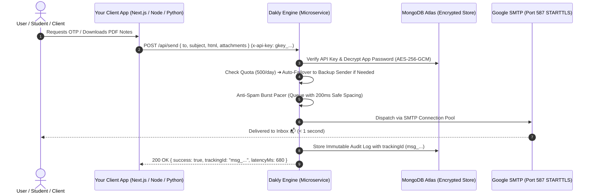

# 📮 Dakly

> **The Zero-Cost, Headless Transactional Email Engine for Developers.**  
> Send OTPs, custom HTML emails, study notes, receipts, and PDF attachments across all your projects with a single API call — powered by your own Gmail SMTP accounts with zero monthly subscription fees.

[](https://github.com/parthpatil1234p-svg/Dakly/actions)
[](LICENSE)
[](https://nodejs.org)
[](https://nodejs.org/api/crypto.html)

---

## 💡 The Problem vs. The Dakly Solution

| Traditional Email (SendGrid / Resend / AWS SES) | Doing Nodemailer in Every Project | 📮 The Dakly Way |
| :--- | :--- | :--- |
| 💳 Requires credit cards & complex domain DNS (SPF, DKIM) verification | 🔄 Copy-pasting Nodemailer configs into 10 different repositories | ⚡ **Zero-Setup Delivery:** 1 HTTP `POST` request from any codebase |
| 💸 Expensive recurring bills once low free tiers expire | ⚠️ Exposing Google App Passwords in multiple `.env` files | 🔐 **Military-Grade AES-256-GCM:** Passwords encrypted at rest |
| ⏱️ Cold start timeouts (10-15s) on serverless lambdas | 🔴 Port 465 SSL handshake timeouts on cloud firewalls | 🚀 **Persistent STARTTLS (Port 587):** OTP delivery in < 1 second |
| 📉 Hard daily limit of 500 emails/day on free Gmail | 🚫 Risk of temporary account ban on rapid bursts | 🛡️ **Failover & Pacing:** Dual-senders (1,000+/day) + 200ms anti-burst spacing |

---

## 🏗️ How It Works (Architecture)



---

## 🚀 Step 1: Get Your API Key

### Option A: Via Modern Web Dashboard (Recommended)
1. Open the **Dakly Dashboard** (locally at `http://localhost:5173` or on your hosted Vercel link).
2. Click **Create an account** (Register with Name, Email, Password).
3. Go to **Projects** ➔ Click **"+ Add Project"**:
   - **Project Name:** e.g., `College Notes Hub` or `Disheera Portal`
   - **Sender Gmail:** Your Gmail address (e.g. `yourname@gmail.com`)
   - **Google App Password:** Your 16-character Google App Password ([Generate one here](https://myaccount.google.com/apppasswords))
4. Click **Save Project** ➔ Copy your generated API Key (`gkey_live_...`).

### Option B: Via Developer API (Headless Registration)
```bash
# 1. Register Developer Account
curl -X POST https://dakly-engin.vercel.app/api/auth/register \
  -H "Content-Type: application/json" \
  -d '{"name": "Dev User", "email": "dev@example.com", "password": "yourPassword123"}'

# 2. Create Project & Obtain API Key
curl -X POST https://dakly-engin.vercel.app/api/projects \
  -H "Content-Type: application/json" \
  -H "Authorization: Bearer <YOUR_JWT_TOKEN>" \
  -d '{
    "name": "My App",
    "senderEmail": "mybot@gmail.com",
    "appPassword": "abcd efgh ijkl mnop"
  }'
```

---

## 🤖 1-Click AI Integration Prompt (Drop-in for Any Project)

> [!TIP]
> **Using an AI Coding Assistant (Cursor, GitHub Copilot, Antigravity, ChatGPT, Claude)?**  
> You don't need to write or refactor code manually! Just copy the readymade prompt below, replace `<YOUR_DAKLY_API_KEY>` with your key, and paste it into your AI assistant inside your project.  
> 
> The AI will automatically inspect your project, detect if you have an existing (broken) email system, replace it without breaking your routes, or create a brand new OTP delivery flow tailored to your tech stack.

```text
You are a senior backend engineer. I need to integrate fast, reliable OTP email delivery into this project using the Dakly Email Engine microservice.

Here are my Dakly Microservice details:
- API Endpoint: https://dakly-engin.vercel.app/api/send
- API Key: <REPLACE_WITH_YOUR_DAKLY_API_KEY>
- Required Header: "x-api-key: <YOUR_API_KEY>"
- HTTP Method: POST
- Payload Schema:
  {
    "to": "recipient@email.com",
    "subject": "Your Verification Code: 123456",
    "html": "<styled html template>",
    "text": "Your OTP code is 123456"
  }

Please execute this integration in my project by following these steps:

1. CODEBASE RECON:
   - Scan my repository to see if an email sending mechanism already exists (e.g. Nodemailer, SendGrid, custom SMTP) or if auth/OTP routes (signup, login, forgot-password) are defined.
   - Identify the framework (Express, Next.js, NestJS, FastAPI, Django, Laravel, etc.) and environment setup (.env).

2. ADAPTIVE IMPLEMENTATION:
   - [SCENARIO A - Existing Email System]: If my codebase already has an email sending function or file (e.g. mailer.js, nodemailer.ts, sendMail.js) that is throwing errors or timeouts, perform a "Drop-in Replacement". Keep the existing function name and parameters so NONE of my existing controllers or routes break, but swap out the broken transport with the Dakly API fetch call.
   - [SCENARIO B - New Setup]: If no email helper exists, create a clean, modular emailService (or otpService) helper and export a sendOtp(to, otp, name) function.

3. RESPONSIVE OTP HTML TEMPLATE:
   - Design a modern, clean HTML card with my project's theme containing:
     - Clear OTP display with styled background, large bold typography, and letter spacing.
     - 10-minute expiration notice.
     - Security disclaimer ("Never share this code with anyone").

4. SECRETS & ENVIRONMENT HYGIENE:
   - Add DAKLY_API_KEY="<YOUR_API_KEY>" and DAKLY_API_URL="https://dakly-engin.vercel.app/api/send" to my .env file (and mirror placeholders in .env.example).
   - Never hardcode the API key in source code.

5. INTERACTIVE CLARIFICATIONS:
   - If you are unsure where OTP generation is triggered or which routes handle verification, ask me clarifying questions one by one before modifying any sensitive routes.
   - Once confirmed, implement the solution and provide a quick test command.
```

---

## 📦 Step 2: Manual Implementation (Code Snippets)

If you prefer writing the integration manually without an AI assistant, you don't need to install `nodemailer` or configure SMTP. Just make a standard `fetch` or HTTP call in your language of choice.

### 1. Node.js / Express / Next.js (JavaScript / TypeScript)

Create a helper file `emailHelper.js` in your project:

```javascript
// emailHelper.js
const DAKLY_API_KEY = process.env.DAKLY_API_KEY || "gkey_live_YOUR_API_KEY";
const DAKLY_ENDPOINT = "https://dakly-engin.vercel.app/api/send";

/**
 * Send OTP Verification Email
 */
export async function sendOtpEmail(to, otpCode, userName = "User") {
  const response = await fetch(DAKLY_ENDPOINT, {
    method: "POST",
    headers: {
      "Content-Type": "application/json",
      "x-api-key": DAKLY_API_KEY
    },
    body: JSON.stringify({
      to,
      subject: `Your Verification Code: ${otpCode}`,
      html: `
        <div style="font-family: Arial, sans-serif; padding: 24px; border: 1px solid #e2e8f0; border-radius: 12px; max-width: 480px;">
          <h2 style="color: #1e293b; margin-top: 0;">Welcome, ${userName}! 👋</h2>
          <p style="color: #475569; font-size: 15px;">Use the following 6-digit code to complete your verification:</p>
          <div style="background: #f1f5f9; padding: 14px; text-align: center; border-radius: 8px; font-size: 30px; font-weight: bold; letter-spacing: 6px; color: #4f46e5; margin: 20px 0;">
            ${otpCode}
          </div>
          <p style="color: #94a3b8; font-size: 13px; margin-bottom: 0;">This code expires in 10 minutes. If you did not request this, please ignore this email.</p>
        </div>
      `
    })
  });

  return await response.json();
}

/**
 * Send Notes / Invoices / PDF Documents
 */
export async function sendPdfDocument(to, title, pdfUrl) {
  const response = await fetch(DAKLY_ENDPOINT, {
    method: "POST",
    headers: {
      "Content-Type": "application/json",
      "x-api-key": DAKLY_API_KEY
    },
    body: JSON.stringify({
      to,
      subject: `Your Document: ${title}`,
      html: `
        <div style="font-family: Arial, sans-serif; padding: 20px;">
          <h2>Here is your document: ${title} 📄</h2>
          <p>Please find the requested PDF attached to this email.</p>
        </div>
      `,
      attachments: [
        {
          filename: `${title}.pdf`,
          path: pdfUrl // Remote URL (Cloudinary / S3 / Firebase) or base64 data URI
        }
      ]
    })
  });

  return await response.json();
}
```

**Usage in your controllers/routes:**
```javascript
import { sendOtpEmail } from './emailHelper.js';

// Inside your Signup/Login route:
const otp = Math.floor(100000 + Math.random() * 900000);
const result = await sendOtpEmail(req.body.email, otp, req.body.name);
console.log("Email Delivery Result:", result);
// Result: { success: true, trackingId: "msg_1792408990_...", status: "DELIVERED" }
```

---

### 2. Python (Requests / FastAPI / Django)

```python
import requests

DAKLY_API_KEY = "gkey_live_YOUR_API_KEY"
DAKLY_URL = "https://dakly-engin.vercel.app/api/send"

def send_email(to_email, subject, html_content, attachments=None):
    headers = {
        "Content-Type": "application/json",
        "x-api-key": DAKLY_API_KEY
    }
    payload = {
        "to": to_email,
        "subject": subject,
        "html": html_content
    }
    if attachments:
        payload["attachments"] = attachments

    response = requests.post(DAKLY_URL, json=payload, headers=headers)
    return response.json()

# Example:
result = send_email("student@example.com", "Your Notes are Ready", "<p>Download your semester notes!</p>")
print(result)
```

---

### 3. cURL (Instant Terminal Test)

```bash
curl -X POST https://dakly-engin.vercel.app/api/send \
  -H "Content-Type: application/json" \
  -H "x-api-key: gkey_live_YOUR_API_KEY" \
  -d '{
    "to": "your-email@gmail.com",
    "subject": "Dakly Test Email",
    "html": "<h1>It works! 🚀</h1><p>Delivered in under 1 second via Dakly.</p>"
  }'
```

---

## 📖 API Reference

### `POST /api/send`
Dispatches a transactional email synchronously.

#### Request Headers:
| Header | Required | Value / Format |
| :--- | :--- | :--- |
| `Content-Type` | **Yes** | `application/json` |
| `x-api-key` | **Yes** | `gkey_live_<64-hex-characters>` |

#### Request Body Parameters:
| Parameter | Type | Required | Description |
| :--- | :--- | :--- | :--- |
| `to` | `string` | **Yes** | Recipient email address (e.g. `user@example.com`) |
| `subject` | `string` | **Yes** | Subject line of the email |
| `html` | `string` | Optional* | Rich HTML body (*either `html` or `text` is required) |
| `text` | `string` | Optional* | Plain text fallback |
| `attachments` | `array` | Optional | Array of attachments: `[{ filename: "file.pdf", path: "https://..." }]` |
| `replyTo` | `string` | Optional | Custom reply-to address |

#### Attachments Support:
- **Remote URLs:** Links to public files on Firebase Storage, AWS S3, Cloudinary, etc.
- **Base64 Data URIs:** `data:application/pdf;base64,...`
- **File Limits:** Up to **15 MB** per individual attachment, **20 MB** total payload per email.

#### Success Response (`200 OK`):
```json
{
  "success": true,
  "trackingId": "msg_1792408990_3df8a4bc12",
  "status": "DELIVERED",
  "sender": "yourcollege@gmail.com",
  "latencyMs": 710,
  "timestamp": "2026-10-19T11:00:00.000Z"
}
```

#### Error Responses:
| Status Code | Meaning | Common Cause |
| :--- | :--- | :--- |
| `400 Bad Request` | Missing `to`, `subject`, or message body | Body validation error |
| `401 Unauthorized` | Invalid or revoked `x-api-key` | Check if API Key matches active project |
| `429 Too Many Requests` | Daily quota exceeded (500/day on single sender) | Add a backup sender in dashboard for failover |
| `502 Bad Gateway` | Google SMTP authentication failed | Invalid 16-character App Password |

---

## 🛡️ Built-in Engine Guardrails

### 1. Dual-Sender Failover (1,000+ Free Emails / Day)
Free Gmail accounts have a 500 emails/day quota limit. Dakly allows you to attach **multiple sender accounts** (Primary + Backup) to a single project.
When the Primary account hits 500 emails, Dakly automatically fails over to the Backup account with **zero downtime**. Quotas automatically reset daily at 00:00 UTC.

### 2. Anti-Spam Smart Pacing
If your client application triggers a burst of requests (e.g. 50 OTP requests within 2 seconds during a college exam registration), Google SMTP would normally trigger a temporary `421` or `454` rate limit block. Dakly automatically serializes dispatches per sender with a **200ms safe spacing queue**, guaranteeing deliverability without dropouts.

### 3. Delivery Webhooks (HMAC-SHA256)
Configure a webhook URL in your project settings (`https://yourapp.com/api/dakly-webhook`). Whenever an email is delivered or bounces, Dakly posts an event signed with an HMAC-SHA256 signature (`x-dakly-signature`).

---

## 💻 Running Locally

### Prerequisites
- Node.js `20.x` or `22.x`
- MongoDB Atlas or local MongoDB instance

### 1. Clone & Setup Backend
```bash
git clone https://github.com/parthpatil1234p-svg/Dakly.git
cd Dakly

# Install backend dependencies
npm install

# Configure environment
cp .env.example .env
# Fill in your MONGODB_URI, ENCRYPTION_MASTER_KEY, and JWT_SECRET in .env

# Run backend
npm start
# -> Backend active on http://localhost:5000
```

### 2. Run React Web Dashboard
```bash
cd frontend

# Install frontend dependencies
npm install

# Run Vite dev server
npm run dev
# -> Dashboard active on http://localhost:5173
```

---

## 🔐 Environment Variables Reference

Create a `.env` file in the root directory:

```env
# Server
PORT=5000
NODE_ENV=development

# Database
MONGODB_URI=mongodb+srv://<username>:<password>@cluster.mongodb.net/dakly?retryWrites=true&w=majority

# Security (AES-256-GCM) - Exactly 64 hex characters (32 bytes)
ENCRYPTION_MASTER_KEY=0123456789abcdef0123456789abcdef0123456789abcdef0123456789abcdef

# JWT Secret for developer authentication
JWT_SECRET=super_secret_jwt_microservice_dev_key_2026
```

---

## 📄 License
Distributed under the **MIT License**. Created by [Parth Patil](https://github.com/parthpatil1234p-svg).
