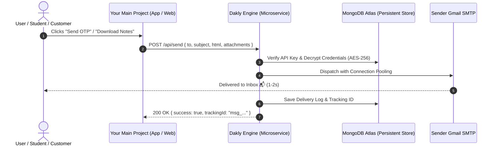

# 📮 Dakly

> **The Zero-Setup Headless Transactional Email Engine for Developers.**  
> Send OTPs, custom HTML emails, notes, receipts, and PDFs across all your projects with a single API call — powered by your own Gmail or SMTP accounts with zero monthly subscription fees.

---

## ✨ Features

- ⚡ **Zero-Setup Delivery Pipeline:** No need to configure Nodemailer or SMTP in every single project. Just make a single `POST` request.
- 🎨 **100% Headless Design Freedom:** Projects design their own HTML/UI, pass their variables, and attach documents/PDFs. Dakly delivers it without meddling with your template.
- 🔐 **Military-Grade Security (AES-256-GCM):** Google App Passwords and credentials are encrypted using authenticated AES-256-GCM encryption.
- 🏢 **Multi-Project & Multi-Tenant:** Manage multiple projects (e.g. College Notes Hub, Document Invoicer, SaaS App) with dedicated sender accounts and unique API keys.
- 📊 **Real-time Delivery Reports & Tracking:** Every email receives an immutable `trackingId` (`msg_...`). Get millisecond-level synchronous delivery status and persistent audit history.
- 🛡️ **Anti-Timeout & Connection Pooling:** Uses persistent SMTP connection pooling to prevent cold starts and delivery latency (OTPs arrive in 1–2 seconds).
- 📈 **Daily Quota Management:** Automatically tracks Gmail's 500 emails/day free threshold per project with automated 24-hour resets.

---

## 🏗️ Architecture



---

## 🚀 Quick Start

### 1. Register a Project
```http
POST /api/projects
Content-Type: application/json

{
  "name": "College Notes Portal",
  "senderEmail": "yourcollege@gmail.com",
  "appPassword": "abcd efgh ijkl mnop"
}
```
**Response:**
```json
{
  "success": true,
  "apiKey": "gkey_live_98a7sd8f7a6sdf...",
  "message": "Project registered successfully!"
}
```

### 2. Send an Email / OTP from Any Project
```javascript
const response = await fetch("https://your-dakly-instance.onrender.com/api/send", {
  method: "POST",
  headers: {
    "Content-Type": "application/json",
    "x-api-key": "gkey_live_98a7sd8f7a6sdf..."
  },
  body: JSON.stringify({
    to: "student@example.com",
    subject: "Your Verification Code",
    html: `<h1>Hello!</h1><p>Your OTP code is <b>849201</b></p>`
  })
});

const report = await response.json();
console.log(report);
// { success: true, status: "DELIVERED", trackingId: "msg_1792354070_..." }
```

---

## 🛠️ Tech Stack

- **Runtime:** Node.js (v20+)
- **Framework:** Express.js
- **Database:** MongoDB Atlas (Mongoose)
- **Encryption:** Node.js Crypto (AES-256-GCM)
- **Transport:** Nodemailer with Connection Pooling
- **Deployment:** Render / Railway / Docker

---

## 📄 License
MIT © [Parth Patil](https://github.com/parthpatil1234p-svg)
