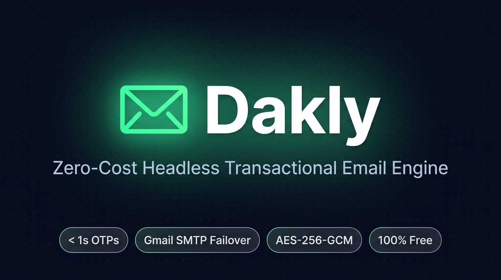
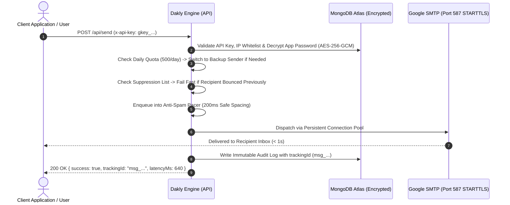

# 📮 Dakly

> **Zero-cost, headless transactional email engine for developers.**  
> Send sub-second OTPs, custom HTML emails, study notes, receipts, and attachments across your projects with a single API call — using your own Gmail SMTP accounts with zero monthly subscription fees.

[](https://github.com/parthpatil1234p-svg/Dakly/releases)
[](https://github.com/parthpatil1234p-svg/Dakly/actions)
[](LICENSE)
[](docs/)
[](CONTRIBUTING.md)
[](SECURITY.md)



---

### Official Documentation
- **[System Architecture](docs/ARCHITECTURE.md)**: Details on pacing queues, connection pooling, encryption, and data schemas.
- **[REST API Reference](docs/API_REFERENCE.md)**: Full endpoint catalog, request/response schemas, and HTTP status codes.
- **[Webhooks Guide](docs/WEBHOOKS.md)**: Event catalog, HMAC-SHA256 signature verification, and multi-language handlers.
- **[Developer SDK Guide](docs/SDK_GUIDE.md)**: Official Node.js (`npm i dakly`) and Python (`pip install dakly`) packages.
- **[Brand Voice Standards](docs/brand-guidelines.md)**: Tone, style guidelines, and copywriting standards.
- **[Contributing Guidelines](CONTRIBUTING.md)**: Local setup, test suite execution, and pull request checklist.
- **[Changelog](CHANGELOG.md)**: Semantic release history and feature updates.

---

## Traditional Email vs. Dakly

| Traditional Providers (SendGrid / Resend / SES) | Custom Nodemailer per Project | Dakly |
| :--- | :--- | :--- |
| Requires credit cards, domain DNS records (SPF, DKIM), and manual approval | Copy-pasting Nodemailer configurations across multiple repositories | **Zero-DNS Setup:** 1 HTTP `POST` request from any codebase |
| Recurring subscription charges once low free tiers expire | Exposing Google App Passwords in multiple `.env` files | **Encrypted at Rest:** Passwords protected with AES-256-GCM |
| Cold-start delays (10–15s) on serverless platforms | Port 465 SSL handshake timeouts on cloud firewalls | **Persistent STARTTLS (Port 587):** OTP delivery in under 1 second |
| Strict 500 emails/day cap on a single Gmail account | Risk of temporary Google account rate-limit blocks | **Failover & Pacing:** Dual senders (1,000+/day) + 200ms anti-burst spacing |

---

## Features

Dakly provides transactional email infrastructure using your existing Gmail credentials:

| Feature | Description | Technical Implementation |
| :--- | :--- | :--- |
| **Sub-Second OTP Delivery** | Sends 4–6 digit OTPs, magic login links, and password resets in under 1 second | Pre-warmed SMTP connection pool over Port 587 STARTTLS |
| **Custom HTML Emails** | Renders custom HTML/CSS layouts for onboarding, notifications, and receipts | Full HTML parsing with automatic plaintext extraction |
| **Attachment Engine** | Delivers PDFs, images, spreadsheets, and ZIP archives up to 15MB each | Supports public remote URLs and Base64 data URIs |
| **Dual-Sender Failover** | Switches to a secondary Gmail account when the primary account reaches 500 emails/day | Extends capacity to 1,000+ free emails/day; resets daily at 00:00 UTC |
| **Burst Pacing Queue** | Spaces out rapid bursts of dispatches | Serialized queue with 200ms spacing to prevent Google `421/454` rate limits |
| **AES-256-GCM Encryption** | Encrypts Google App Passwords at rest | 32-byte master key with unique 16-byte IVs and authenticated tags |
| **Sender Aliases** | Sends emails using configured Gmail aliases (`support@yourdomain.com`) | Case-insensitive alias matching with automatic failover to the owning sender |
| **Custom Templates (Pro)** | Create and edit custom HTML templates with `{{variable}}` syntax | Dynamic interpolation, variable schema validation, and live preview sandbox |
| **Built-in Templates** | 5 responsive templates: OTP, Welcome, Password Reset, College Notes, and Receipts | Built-in CSS, dark/light client support, and 1:1 project brand logo embed |
| **Open & Click Tracking** | Tracks opens and click-through rates | 1x1 zero-cache GIF pixel, secure 302 link redirects, and device detection |
| **Smart Warm-up** | Gradually ramps volume for new Gmail accounts across 6 days (25 → 500/day) | Protects account health and prevents algorithmic spam flags |
| **Hard Bounce Suppression** | Automatically records permanent delivery failures (`550`, `551`, `553`) | Proactively blocks future sends to bad addresses (`BLOCKED_SUPPRESSED`) |
| **HMAC Delivery Webhooks** | Emits real-time HTTP events (`delivered`, `failed`, `suppressed`, `opened`, `clicked`) | Signed with HMAC-SHA256 headers (`x-dakly-signature`) |
| **IP Whitelisting & Key Rotation** | Restricts API access to specific server IPs (exact, CIDR `/24`, or wildcard `*`) | 1-click zero-downtime key rotation invalidates old keys instantly |
| **Team Workspaces** | Multi-seat project management with Owner, Admin, and Viewer roles | Role-based access control with automatic invite linking on signup |
| **Client SDKs** | Official Node.js/TypeScript and Python libraries | Typed methods, automatic retries, and error classification |

---

## Architecture Flow



---

## Quick Start: Getting an API Key

### Option A: Web Dashboard
1. Open the **Dakly Dashboard** at [https://dakly.cc.cd](https://dakly.cc.cd) (or run locally at `http://localhost:5173`).
2. Register an account with your name, email, and password.
3. Click **Projects** ➔ **+ Add Project**:
   - **Project Name:** e.g., `Acme Portal`
   - **Sender Gmail:** Your Gmail address (`you@gmail.com`)
   - **Google App Password:** 16-character App Password ([Google Account Security](https://myaccount.google.com/apppasswords))
4. Copy your generated API key (`gkey_live_...`).

### Option B: HTTP API Registration
```bash
# 1. Register developer account
curl -X POST https://dakly.cc.cd/api/auth/register \
  -H "Content-Type: application/json" \
  -d '{"name": "Dev User", "email": "dev@example.com", "password": "yourPassword123"}'

# 2. Create project and generate API key
curl -X POST https://dakly.cc.cd/api/projects \
  -H "Content-Type: application/json" \
  -H "Authorization: Bearer <YOUR_JWT_TOKEN>" \
  -d '{
    "name": "Production Service",
    "senderEmail": "service@gmail.com",
    "appPassword": "abcd efgh ijkl mnop"
  }'
```

---

## Official SDKs

### Node.js / TypeScript (`npm i dakly`)
```bash
npm install dakly
```

```javascript
import { Dakly, DaklySuppressedError } from 'dakly';

const dakly = new Dakly(process.env.DAKLY_API_KEY || 'gkey_live_...');

// 1. One-line OTP delivery
const otpRes = await dakly.sendOtp({
  to: 'user@example.com',
  code: '849201',
  appName: 'CampusPortal',
  expiresInMinutes: 10,
});
console.log('Delivered! Tracking ID:', otpRes.trackingId);

// 2. Pre-built Welcome Template
await dakly.sendWelcome({
  to: 'user@example.com',
  name: 'Alex Rivera',
  appName: 'CampusPortal',
  loginUrl: 'https://campus.example.edu/login',
});

// 3. Notes & PDF Attachment Delivery
await dakly.sendNotes({
  to: 'student@college.edu',
  studentName: 'Amit',
  subjectName: 'Computer Networks',
  notesTitle: 'Unit 3: TCP Congestion Control',
  downloadUrl: 'https://college.edu/notes/cn-unit3.pdf',
  attachments: [{ filename: 'CN_Notes.pdf', path: 'https://college.edu/notes/cn-unit3.pdf' }],
});

// 4. Ping Server & Check Remaining Daily Capacity
const ping = await dakly.ping();
console.log(`Remaining quota: ${ping.capacity.remainingToday} / ${ping.capacity.totalDailyQuota}`);
```

### Python 3.8+ (`pip install dakly`)
```bash
pip install dakly
```

```python
from dakly import Dakly

dakly = Dakly("gkey_live_...")

# Send OTP
res = dakly.send_otp(to="user@example.com", code="849201", app_name="StudyHub")
print("Tracking ID:", res["trackingId"])

# Send Onboarding Welcome
dakly.send_welcome(to="user@example.com", name="Alex", app_name="StudyHub")

# Health Check & Quota
ping = dakly.ping()
print("Remaining quota today:", ping["capacity"]["remainingToday"])
```

---

## Raw HTTP Implementation (Zero Dependencies)

If you prefer standard HTTP requests without installing packages, call `POST /api/send` directly:

### 1. Node.js `fetch` (ESM / Next.js / Express)
```javascript
const DAKLY_API_KEY = process.env.DAKLY_API_KEY;
const DAKLY_ENDPOINT = 'https://dakly.cc.cd/api/send';

export async function sendOtpEmail(to, otpCode, userName = 'User') {
  const response = await fetch(DAKLY_ENDPOINT, {
    method: 'POST',
    headers: {
      'Content-Type': 'application/json',
      'x-api-key': DAKLY_API_KEY,
    },
    body: JSON.stringify({
      to,
      subject: `Your Verification Code: ${otpCode}`,
      html: `
        <div style="font-family: sans-serif; padding: 24px; border: 1px solid #e2e8f0; border-radius: 8px; max-width: 480px;">
          <h2 style="color: #0f172a; margin-top: 0;">Verification Code</h2>
          <p style="color: #475569;">Hello ${userName}, use this code to sign in:</p>
          <div style="background: #f8fafc; border: 1px dashed #cbd5e1; padding: 16px; text-align: center; font-size: 28px; font-weight: bold; letter-spacing: 6px; color: #1e40af;">
            ${otpCode}
          </div>
          <p style="color: #94a3b8; font-size: 12px; margin-top: 16px;">Expires in 10 minutes. If you did not request this, you can ignore this email.</p>
        </div>
      `,
    }),
  });

  return await response.json();
}
```

### 2. Python `requests`
```python
import requests

DAKLY_API_KEY = "gkey_live_..."
DAKLY_ENDPOINT = "https://dakly.cc.cd/api/send"

def send_email(to_email, subject, html_content, attachments=None):
    payload = {
        "to": to_email,
        "subject": subject,
        "html": html_content
    }
    if attachments:
        payload["attachments"] = attachments

    res = requests.post(
        DAKLY_ENDPOINT,
        headers={"Content-Type": "application/json", "x-api-key": DAKLY_API_KEY},
        json=payload
    )
    return res.json()
```

### 3. cURL
```bash
curl -X POST https://dakly.cc.cd/api/send \
  -H "Content-Type: application/json" \
  -H "x-api-key: gkey_live_YOUR_API_KEY" \
  -d '{
    "to": "recipient@example.com",
    "subject": "Dakly Verification Test",
    "html": "<h2>Verification Test</h2><p>Delivered via Dakly in under 1 second.</p>"
  }'
```

---

## API Reference

### `POST /api/send`
Dispatches an email synchronously through the sender pool.

#### Headers
| Header | Required | Format |
| :--- | :--- | :--- |
| `Content-Type` | Yes | `application/json` |
| `x-api-key` | Yes | `gkey_live_<64-hex-chars>` |

#### Body Parameters
| Parameter | Type | Required | Description |
| :--- | :--- | :--- | :--- |
| `to` | `string` | Yes | Recipient email address |
| `subject` | `string` | Optional* | Email subject line (auto-generated when using pre-built templates) |
| `html` | `string` | Optional* | HTML email body (*either `html`, `text`, or `template` is required) |
| `text` | `string` | Optional* | Plain text body fallback |
| `template` | `string` | Optional | Template identifier (`otp`, `welcome`, `password_reset`, `notes_delivery`, `receipt`, or custom template ID) |
| `vars` | `object` | Optional | Dynamic key-value pairs interpolated into template placeholders |
| `alias` | `string` | Optional | Specific sender alias address (`support@yourdomain.com`) |
| `attachments` | `array` | Optional | List of files: `[{ "filename": "report.pdf", "path": "https://..." }]` |
| `replyTo` | `string` | Optional | Custom reply-to address |

#### Attachments
- **Remote URLs**: Public HTTPS links (S3, Cloudinary, Firebase Storage).
- **Base64 URIs**: Formatted as `data:application/pdf;base64,...`.
- **Limits**: Up to 15 MB per file; 20 MB total payload per dispatch.

#### Responses

**Success (`200 OK`)**:
```json
{
  "success": true,
  "trackingId": "msg_1792408990_3df8a4bc12",
  "status": "DELIVERED",
  "sender": "service@gmail.com",
  "latencyMs": 680,
  "timestamp": "2026-11-16T10:00:00.000Z"
}
```

**Common Error Codes**:
| Code | Reason | Resolution |
| :--- | :--- | :--- |
| `400 Bad Request` | Missing `to` or message body | Include `to` and one of `html`, `text`, or `template` |
| `401 Unauthorized` | Invalid or revoked API key | Verify key matches active project in dashboard |
| `403 Forbidden` | IP address blocked by whitelist | Add client IP in **Security & Team** whitelist |
| `404 Not Found` | Unknown template ID | Use a valid template ID (`otp`, `welcome`, `receipt`, etc.) |
| `429 Too Many Requests` | Daily sending quota reached | Add a backup Gmail account in project settings |
| `502 Bad Gateway` | Google SMTP authentication rejected | Re-generate 16-character Google App Password |

---

## Pre-Built & Custom Templates

### 1. Built-in Templates

| Template ID | Purpose | Variables (`vars`) |
| :--- | :--- | :--- |
| `otp` | Verification codes, 2FA, passwordless login | `code`, `name`, `validMinutes`, `actionName` |
| `welcome` | User onboarding greetings with primary CTA button | `name`, `actionUrl`, `actionText`, `introMessage` |
| `password_reset` | Password recovery links with IP/device notices | `name`, `resetUrl`, `validMinutes`, `ipAddress`, `deviceInfo` |
| `notes_delivery` | Academic notes, study material, and PDF attachments | `studentName`, `subject`, `notesTitle`, `semester`, `downloadUrl` |
| `receipt` | Payment confirmations, invoices, and itemized billing | `customerName`, `invoiceNumber`, `amount`, `date`, `paymentMethod`, `planName`, `receiptUrl` |

### 2. Custom Templates & Paid Pro Tier

Paid Pro projects support custom transactional templates:
- Write custom HTML with variable placeholders: `{{userName}}`, `{{{unescapedHtml}}}`.
- Dynamic preview studio with variable schema inspector.
- Automatically wrapped in your verified 1:1 brand logo, header, and clean footer shell (or bypass wrapping by supplying a full `<!DOCTYPE html>` document).
- **Pro Monthly**: ₹20 / month
- **Pro Annual Pass**: ₹216 / year *(monthly × 12 with 10% discount applied, saving ₹24)*

---

## Delivery Webhooks (HMAC-SHA256)

Receive real-time HTTP event notifications on delivery status, opens, clicks, and bounces.

### Events
- `email.delivered`: SMTP returned `250 OK`.
- `email.failed`: Dispatch rejected by SMTP.
- `email.suppressed`: Blocked before dispatch due to previous hard bounce.
- `email.opened`: Tracking pixel loaded by recipient client.
- `email.clicked`: Recipient clicked a tracked hyperlink.
- `webhook.test`: Test event triggered from the dashboard.

### Verification (`x-dakly-signature`)
Dakly computes a cryptographic HMAC-SHA256 digest using your Webhook Secret (`daksec_...`):

```javascript
import express from 'express';
import { Dakly } from 'dakly';

const app = express();
app.use(express.json());

app.post('/api/webhooks/dakly', (req, res) => {
  const signature = req.headers['x-dakly-signature'];
  const isValid = Dakly.verifyWebhookSignature({
    payload: req.body,
    signature,
    secret: process.env.DAKLY_WEBHOOK_SECRET,
  });

  if (!isValid) {
    return res.status(401).json({ error: 'Invalid HMAC signature' });
  }

  const { event, trackingId, recipient } = req.body;
  console.log(`Event ${event} for ${recipient} (Tracking: ${trackingId})`);
  res.status(200).json({ received: true });
});
```

---

## Security & Team Workspaces

- **AES-256-GCM Encryption**: Google App Passwords are encrypted before database storage using 32-byte keys, 16-byte random IVs, and authenticated tags. Plaintext passwords are never stored or logged.
- **Server IP Whitelisting**: Lock API access to explicit IP addresses (`203.0.113.195`), CIDR subnets (`192.168.1.0/24`), or wildcard patterns (`192.168.1.*`). Unauthorized IPs receive `403 IP_NOT_WHITELISTED`.
- **1-Click Key Rotation**: Regenerate API keys instantly without restarting services.
- **Team Roles (RBAC)**: Assign Owner, Admin, or Viewer permissions to teammates without sharing Gmail credentials.

---

## Local Development & Testing

### Prerequisites
- Node.js `20.x` or `22.x`
- MongoDB instance (Atlas or local)

### 1. Setup Backend
```bash
git clone https://github.com/parthpatil1234p-svg/Dakly.git
cd Dakly

# Install dependencies
npm install

# Configure environment
cp .env.example .env
# Set MONGODB_URI, ENCRYPTION_MASTER_KEY (64 hex characters), and JWT_SECRET

# Run unit tests
npm test

# Start backend server
npm start
# -> Backend listening on http://localhost:5000
```

### 2. Setup Frontend Dashboard
```bash
cd frontend

# Install dependencies
npm install

# Run Playwright UI & WCAG AA accessibility tests
npm run test:ui

# Start Vite development server
npm run dev
# -> Dashboard active on http://localhost:5173
```

---

## Environment Variables Reference

| Variable | Required | Description | Example |
| :--- | :--- | :--- | :--- |
| `PORT` | No | Server port (defaults to 5000) | `5000` |
| `NODE_ENV` | No | Environment mode | `production` / `development` |
| `MONGODB_URI` | Yes | MongoDB connection string | `mongodb+srv://...` |
| `ENCRYPTION_MASTER_KEY` | Yes | 64-character hex string (32 bytes) for AES-256-GCM | `0123456789abcdef...` |
| `JWT_SECRET` | Yes | Secret key used to sign developer JWT sessions | `super_secret_jwt_key...` |

---

## License

Distributed under the **MIT License**. Created by [Parth Patil](https://github.com/parthpatil1234p-svg).
